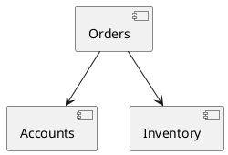

# Advanced Rules

This guide covers the APIs that make ArchTest practical in larger codebases:
app scoping, freeze baselines, import filters, function-level call metadata,
reusable rules, captured slices, PlantUML conformance, and extra metrics.

## App Scoping

Prefer scoping architecture tests to the OTP application under test:

```elixir
defmodule MyApp.ArchTest do
  use ExUnit.Case
  use ArchTest, app: :my_app

  test "domain does not call web" do
    modules_matching("MyApp.Domain.**")
    |> should_not_depend_on(modules_matching("MyAppWeb.**"))
  end
end
```

The `app:` option is automatically forwarded to assertion, layer, onion, and
modulith checks. You can override it per rule:

```elixir
modules_matching("OtherApp.**")
|> should_be_free_of_cycles(app: :other_app)
```

## Empty Matches

Rules fail when the subject matches zero modules. This catches typoed patterns.
Allow an empty set only when it is intentional:

```elixir
modules_matching("MyApp.Legacy.**")
|> should_not_depend_on(modules_matching("MyApp.NewCore.**"), allow_empty: true)
```

## Auto Freeze

Use `freeze: true` to baseline every assertion in a test module:

```elixir
defmodule MyApp.LegacyArchTest do
  use ExUnit.Case
  use ArchTest, app: :my_app, freeze: true

  test "legacy code must not get worse" do
    modules_matching("MyApp.**")
    |> should_not_depend_on(modules_matching("MyApp.Legacy.**"),
      rule_id: "legacy_dependency_rule")
  end
end
```

Run once with:

```sh
ARCH_TEST_UPDATE_FREEZE=true mix test
```

Freeze baselines use structured violation keys from `%ArchTest.Violation{}`.
This is more stable than parsing rendered ExUnit output. Empty-pattern control
failures are not freezable; fix the pattern or pass `allow_empty: true` when an
empty set is intentional.

When `freeze: true` is enabled, ArchTest generates a rule id from the test
module, assertion name, assertion arguments, and scope options such as `:app`,
`:apps`, `:paths`, `:include`, and `:exclude`. Pass `rule_id:` for rules whose
baseline filename should stay stable while the implementation changes.

## Import Filters

Limit imported BEAM modules with `:include`, `:exclude`, `:apps`, or `:paths`:

```elixir
graph =
  ArchTest.Collector.build_graph(:my_app,
    include: ["MyApp.**"],
    exclude: ["MyApp.TestSupport.**"],
    force: true)
```

Multi-app and path-based imports are supported:

```elixir
ArchTest.Collector.build_graph(:all, apps: [:my_app, :my_app_web])
ArchTest.Collector.build_graph_from_paths(["_build/test/lib/my_app/ebin"])
```

Filters are applied to graph keys and dependency edges, so excluded modules do
not leak back through `dependencies_of/2` or transitive dependency traversal.
Assertions, metrics, reusable rules, layer checks, onion checks, modulith
checks, convention helpers, and PlantUML enforcement all accept `:graph` for
tests and the collector scope options when they need to build a graph.

## Call Metadata

For rules that need exact call sites, use function-level metadata:

```elixir
calls = ArchTest.Collector.calls(:my_app, include: ["MyApp.**"])

Enum.each(calls, fn call ->
  IO.inspect({call.caller_module, call.caller_function, call.callee_module, call.line})
end)
```

`%ArchTest.Call{}` includes caller module/function, callee module/function,
source file, and line when debug info is available. Include/exclude filters are
applied to callers and callees, and compiler-generated metadata calls are
omitted. Remote function captures, such as `&MyApp.Accounts.create_user/1`, and
static `apply(MyApp.Accounts, :create_user, args)` calls are reported when the
compiled debug information exposes them.

## Reusable Rules

Use `ArchTest.Rule` when a rule needs to be shared, ignored, or frozen:

```elixir
rule =
  ArchTest.Rule.new("web must not call repos", fn graph ->
    for {caller, deps} <- graph,
        caller |> Atom.to_string() |> String.starts_with?("Elixir.MyAppWeb."),
        dep <- deps,
        dep |> Atom.to_string() |> String.ends_with?("Repo") do
      ArchTest.Violation.forbidden_dep(caller, dep, "web layer must call contexts")
    end
  end)
  |> ArchTest.Rule.ignore(callee: "MyApp.LegacyRepo")
  |> ArchTest.Rule.freeze("web_repo_rule")

ArchTest.Rule.assert(rule, app: :my_app)
```

## Captured Slices

Instead of listing slices manually, capture one namespace segment:

```elixir
define_slices_by("MyApp.(*)", app: :my_app,
  except: ["MyApp.Application", "MyApp.Repo"])
|> allow_dependency(:orders, :accounts)
|> enforce_isolation()
```

`"MyApp.(*)"` turns modules such as `MyApp.Orders`, `MyApp.Orders.Checkout`,
and `MyApp.Inventory.Repo` into `orders: "MyApp.Orders"` and
`inventory: "MyApp.Inventory"`.

Wildcards may appear before the capture. For example, `"MyApp.*.(*)"` can
derive slices from modules like `MyApp.Bounded.Orders.Checkout`; the captured
segment still becomes the slice name and root.

## PlantUML Conformance

Keep diagrams honest by checking actual slice dependencies against PlantUML:



```elixir
ArchTest.PlantUML.enforce("docs/components.puml",
  app: :my_app,
  slices: [
    orders: "MyApp.Orders",
    accounts: "MyApp.Accounts",
    inventory: "MyApp.Inventory"
  ])
```

Any actual slice dependency missing from the diagram fails the test.
Line comments (`'` and `//`) and PlantUML block comments (`/' ... '/`) are
ignored, so commented-out edges do not accidentally permit dependencies.

## Extra Metrics

In addition to Martin metrics, ArchTest exposes simple graph metrics:

```elixir
assert ArchTest.Metrics.afferent("MyApp.Orders", app: :my_app) >= 1
assert ArchTest.Metrics.efferent("MyApp.Orders", app: :my_app) < 10
assert ArchTest.Metrics.fan_out(MyApp.Orders, app: :my_app) < 5
assert ArchTest.Metrics.fan_in(MyApp.Accounts, app: :my_app) >= 1
assert ArchTest.Metrics.dependency_depth(MyApp.Orders.Checkout, app: :my_app) <= 3
```

`coupling/2`, `instability/2`, `abstractness/2`, `afferent/2`, and
`efferent/2` treat a binary namespace such as `"MyApp.Orders"` as one package:
the root module plus descendants. Pass a module atom, such as `MyApp.Orders`, to
measure only that exact module.
