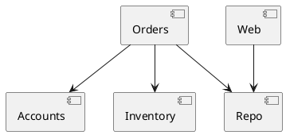

# FixtureApp Architecture Examples

This fixture is a small real Mix project used by ArchTest integration tests.
It is compiled before the root test suite runs, then ArchTest reads its BEAM
files from:

```text
test/support/fixture_app/_build/dev/lib/fixture_app/ebin
```

The app intentionally contains both valid and invalid architecture edges so the
tests can prove success and failure paths.

## Contexts

- `FixtureApp.Orders` is the public Orders API.
- `FixtureApp.Accounts` is the public Accounts API.
- `FixtureApp.Inventory` is the public Inventory API.
- `FixtureApp.Repo` is persistence infrastructure.
- `FixtureApp.Web` is the web-facing layer.

Intentional violations:

- `FixtureApp.Orders.Checkout` calls `FixtureApp.Inventory.Repo`.
- `FixtureApp.Orders.OrderService` calls `FixtureApp.Repo.OrderRepo`.
- `FixtureApp.Web.Controller` calls `FixtureApp.Repo.OrderRepo`.
- `FixtureApp.Domain.CycleA` and `FixtureApp.Domain.CycleB` form a cycle.

## PlantUML Diagram

`docs/components.puml` documents the current known slice dependencies:



The test suite checks this diagram with:

```elixir
ArchTest.PlantUML.enforce("test/support/fixture_app/docs/components.puml",
  graph: graph,
  slices: [
    accounts: "FixtureApp.Accounts",
    inventory: "FixtureApp.Inventory",
    orders: "FixtureApp.Orders",
    repo: "FixtureApp.Repo",
    web: "FixtureApp.Web"
  ])
```

If the compiled code adds a new cross-slice dependency that is missing from the
diagram, the PlantUML test fails.

## What The Fixture Tests Cover

See `test/arch_test/fixture_app_examples_test.exs` for executable examples of:

- PlantUML conformance against a real `.puml` file.
- `define_slices_by/2` using the real fixture modules.
- `ArchTest.Collector.calls_from_path/2` with real file and line metadata.
- `ArchTest.Rule` with ignore filters on real dependency violations.
- New metrics such as `afferent/2`, `efferent/2`, and `dependency_depth/2`.
